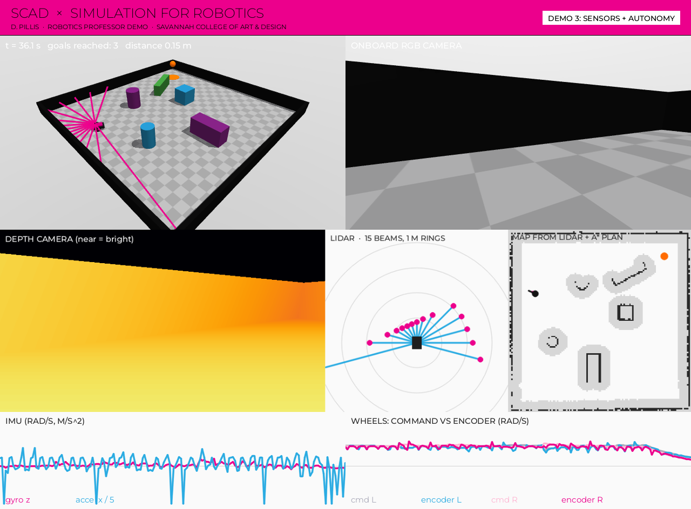
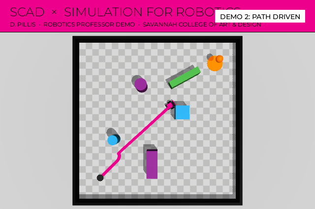
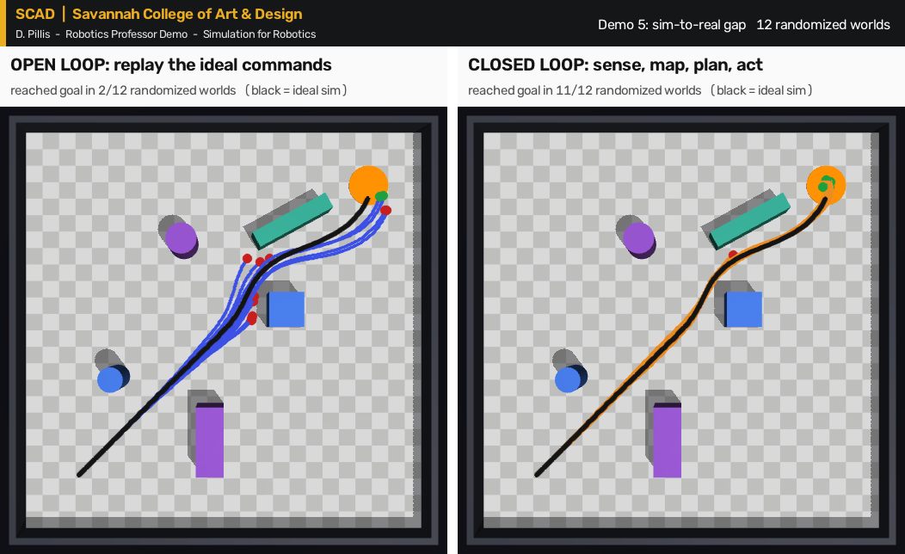

# SCAD · Savannah College of Art & Design — D. Pillis Robotics Professor Demo

## Simulation for Robotics: Lecture, Live Demo and Discussion



Simulation accelerates robotics research and education by providing a safe,
scalable, and cost-effective environment to test algorithms before deploying on
physical hardware. This lecture and demo explore why simulation is
indispensable, contrasting leading platforms like NVIDIA Isaac Sim, mjlab, and
Unity to guide engine selection for specific research and classroom needs. A
live demonstration highlights physics fidelity, sensor emulation, and rapid
prototyping capabilities. The session concludes with an interactive Q&A and
curated resource sharing for immediate implementation.

---

## Website

The session's website is in [`docs/`](docs/index.html) and is served by GitHub Pages at
**https://mrpillis.github.io/scad-robotics-simulation-demo/** once Pages is turned on
(Settings → Pages → Deploy from a branch → `main` → `/docs`).

## Learning objectives

**Session goals**
- Explain the critical role of simulation in modern robotics development, testing, and education.
- Compare industry-standard simulation platforms to help educators and researchers choose the right workflow.
- Showcase a live (digital) robot simulation to illustrate real-time physics, perception pipeline integration, and environment interaction.
- Provide accessible learning resources and lead an open discussion to support practical adoption.

**Students will be able to**
- Evaluate simulation frameworks (e.g., Isaac Sim, Unity, etc) based on physics realism, GPU acceleration, and sensor fidelity.
- Identify key advantages and constraints of running robotics algorithms in simulated environments versus physical hardware.
- Demonstrate basic robot control and sensor visualization within a real-time simulation engine.
- Select appropriate simulation tools tailored for specific coursework or advanced research projects.

## Session structure

| # | Section | Mode | Objectives covered | Notes |
| --- | --- | --- | --- | --- |
| 0 | Run of show | — | all | [lecture/00-run-of-show.md](lecture/00-run-of-show.md) — timings, transitions, fallbacks |
| 1 | Why simulation | Lecture | role in development, testing, education | [lecture/01-why-simulation.md](lecture/01-why-simulation.md) |
| 2 | Choosing a platform | Lecture | compare platforms; evaluate on physics realism, GPU acceleration, sensor fidelity | [lecture/02-choosing-a-platform.md](lecture/02-choosing-a-platform.md) |
| 3 | Live demonstration | **Demo** | real-time physics, perception pipeline, environment interaction; basic control and sensor visualization | [lecture/03-live-demo.md](lecture/03-live-demo.md) · [demo/](demo) |
| 4 | Simulation vs. hardware | Lecture | advantages and constraints | [lecture/04-sim-vs-hardware.md](lecture/04-sim-vs-hardware.md) |
| 5 | Selecting tools | Lecture | tools for coursework and research | [lecture/05-selecting-tools.md](lecture/05-selecting-tools.md) |
| 6 | Discussion and resources | Q&A | learning resources, practical adoption | [lecture/06-discussion.md](lecture/06-discussion.md) |

## Handouts

The presentation is a studio-class demonstration: lecture, then process
demonstrated live, then discussion. It comes with four handouts, also bound
together as a printable PDF in [`handouts/print/`](handouts/print).

| Handout | What it is |
| --- | --- |
| [Vocabulary list](handouts/01-vocabulary.md) | ~50 terms and concepts from the session, grouped by topic |
| [Additional learning resources](handouts/02-learning-resources.md) | Notebooks to start today, platform docs, books, video courses, key papers |
| [Leave-behind project](handouts/03-leave-behind-project.md) | "Teach a Robot to Find Its Way": three common parts, then a Studio, Engineering or Research track, with a rubric |
| [Visual guide](handouts/04-visual-guide.md) | The autonomy loop, anatomy of a robot file, both perception pipelines, the sim-to-real figure, a platform strength map, a checklist |

## Quick start

Runs on any laptop (macOS, Windows, Linux); no GPU needed.

```bash
git clone https://github.com/mrpillis/scad-robotics-simulation-demo
cd scad-robotics-simulation-demo
pip install -r requirements-demo.txt

python demo/02_drive_the_robot.py        # macOS: mjpython demo/02_drive_the_robot.py
python demo/03_sensor_dashboard.py
```

On macOS, MuJoCo's interactive 3-D viewer must be started with `mjpython`
(installed with MuJoCo). Demos 3 and 4 open their own dashboard window and run
with plain `python` everywhere.

## The live demo

A small differential-drive rover in a 6 × 6 m studio, carrying wheel encoders,
an IMU, a bumper, a 15-beam lidar and an RGB-D camera — all defined in one
readable file, [`demo/assets/scad_lab.xml`](demo/assets/scad_lab.xml). Shared
code (kinematics, controllers, mapping, A*, perception, dashboard) is in
[`demo/scad_sim.py`](demo/scad_sim.py), written to be read aloud.

| Demo | Shows | Run | Fallback video |
| --- | --- | --- | --- |
| **1 · Physics playground** | Physics realism: foam, rubber, steel; time step and stability | `python demo/01_physics_playground.py` | [mp4](demo/output/01_physics_playground.mp4) |
| **2 · Drive the robot** | Basic control: keyboard teleop, differential-drive kinematics, a P-controller that crashes without sensing | `python demo/02_drive_the_robot.py` | [mp4](demo/output/02_drive_the_robot.mp4) |
| **3 · Sensor dashboard** | Sensor visualization and the perception pipeline: lidar → map → A* → pure pursuit | `python demo/03_sensor_dashboard.py` | [mp4](demo/output/03_sensor_dashboard.mp4) |
| **4 · Camera perception** | RGB → HSV → threshold → blob → steering; search, track, arrive | `python demo/04_camera_perception.py` | [mp4](demo/output/04_camera_perception.mp4) |
| **5 · Sim-to-real gap** | Domain randomization: open loop vs. closed loop in 12 worlds | `python demo/05_sim_to_real_gap.py` | [png](demo/output/05_sim_to_real_gap.png) |
| 6 · Scale and speed | Real-time factor and parallel throughput of this laptop | `python demo/06_scale_and_speed.py` | — |
| 7 · Robot arena | Capstone: the full ArtifactArena competition engine (first: `pip install -r requirements-arena.txt`) | `python demo/07_robot_arena_match.py` | `WITH_ARENA=1 bash demo/render_all.sh` |

Add `--headless` to Demos 1–4 to record a video instead of opening a window.
`bash demo/render_all.sh` refreshes every fallback video and the handout images.

| Demo 2: control without sensing | Demo 5: the sim-to-real gap |
| --- | --- |
|  |  |

## Repository layout

```text
README.md                 this page
docs/                     the website (GitHub Pages): index.html + site_assets/
lecture/                  the six sections of the session, plus the run of show
handouts/                 vocabulary, resources, leave-behind project, visual guide; img/; print/
demo/                     the live demos, the scene file, fallback renders in demo/output/
  scad_sim.py             shared teaching toolkit
  assets/scad_lab.xml     the rover and its studio (MJCF)
tests/test_scad_demo.py   smoke tests for the demos

mjarena/                  ArtifactArena engine (MuJoCo robot competition), used by Demo 7
run_episode_viewer.py     run and watch arena matches
run_baseline_agent.py     ArtifactArena's model-driven robot design harness (research track)
configs/, scripts/        engine rules, model configs, acceleration builds
tests/, tests_environment/  engine test suites
UPSTREAM_README.md        the original ArtifactArena README
```

## Tests

```bash
python -m pytest tests/test_scad_demo.py -q           # the teaching demos (seconds)
python -m pytest tests -q                             # plus the ArtifactArena harness
python -m pytest tests_environment -q -k 'not full_300_second_round'
```

## Credits and license

This repository is a fork of
[ArtifactArena/harness-public](https://github.com/ArtifactArena/harness-public)
by Kushagra Tiwary, David Mayo, Nikhil Behari, Xiangzhou Sun, Abdulrahman
Alabdulkareem, Isaac Galatzer-Levy, Boris Katz and Brian Cheung
(InfoLab, MIT CSAIL; Camera Culture, MIT Media Lab; NYU Grossman School of
Medicine; Discovery Lab, UCSF). The `mjarena/` engine, its configs, scripts and
tests are theirs; see [UPSTREAM_README.md](UPSTREAM_README.md) and cite their
paper if you use the engine:

```bibtex
@article{artifactarena2026,
  title  = {ArtifactArena: Evaluating Models by What They Build in the Physical World},
  author = {Tiwary, Kushagra and Mayo, David and Behari, Nikhil and Sun, Xiangzhou and
            Alabdulkareem, Abdulrahman and Galatzer-Levy, Isaac and Katz, Boris and Cheung, Brian},
  year   = {2026},
  url    = {https://artifactarena.ai}
}
```

The lecture notes, handouts and `demo/` were written for this SCAD presentation
by D. Pillis. Physics by [MuJoCo](https://mujoco.org) (Google DeepMind).

MIT License — see [LICENSE](LICENSE).

*This is an independent presentation repository and is not an official
publication of the Savannah College of Art and Design.*
