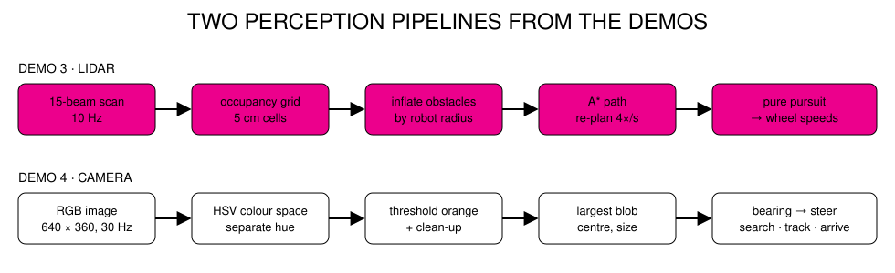

# Handout 4 · Visual Guide

**Simulation for Robotics — SCAD · Savannah College of Art & Design — D. Pillis, Robotics Professor Demo**

## 1 · The autonomy loop


Everything inside the dashed green outline is your code. In simulation the arrows connect to a
physics engine; on a robot they connect to drivers. Keep that boundary clean and
the same code runs in both.

## 2 · Anatomy of a robot file

The demo rover, abridged from [`demo/assets/scad_lab.xml`](../demo/assets/scad_lab.xml):

```xml
<body name="rover" pos="-2.2 -2.2 0.07">            <!-- WHERE: start pose -->
  <freejoint/>                                       <!-- HOW IT MOVES: free in 3-D -->
  <geom type="box" size="0.16 0.11 0.035" mass="3"/> <!-- WHAT: chassis shape and mass -->
  <camera name="rover_cam" pos="0.09 0 0.16" .../>   <!-- SENSE: onboard camera -->
  <site name="beam_07" zaxis="1 0 0"/>               <!-- SENSE: one lidar beam -->
  <body name="wheel_left" pos="0.03 0.135 0">
    <joint name="wheel_left" type="hinge" axis="0 1 0"/>
    <geom type="cylinder" size="0.07 0.02" friction="1.2"/>
  </body>
</body>

<actuator>
  <velocity name="motor_left" joint="wheel_left" kv="8" forcerange="-0.6 0.6"/>  <!-- ACT -->
</actuator>
<sensor>
  <jointvel name="enc_left" joint="wheel_left"/>     <!-- encoder -->
  <gyro name="imu_gyro" site="imu"/>                 <!-- IMU -->
  <rangefinder name="lidar_07" site="beam_07"/>      <!-- lidar beam -->
</sensor>
```

## 3 · Two perception pipelines



## 4 · One dashboard, every sensor (Demo 3)


Top: studio camera with lidar rays; onboard camera. Middle: depth camera
(bright = near); lidar scan; the occupancy map the robot built, with its A* plan
(gold) and goal (orange). Bottom: IMU; wheel speed commanded vs. measured.

## 5 · The camera pipeline, frame by frame (Demo 4)


## 6 · The sim-to-real gap (Demo 5)


Same robot, same goal, twelve plausible "realities" (friction, mass, motor
strength, sensor noise, latency). Replaying commands that were perfect in the
ideal simulator fails in most of them; sensing and re-planning succeeds in
nearly all.

## 7 · Where each platform is strongest

Presenter's summary for classroom selection (see Segment 2 for details and sources).

| | Physics realism | GPU acceleration | Sensor fidelity | Runs on any student laptop | Art / design pipeline fit |
| --- | :---: | :---: | :---: | :---: | :---: |
| **Isaac Sim / Isaac Lab** | ●●● | ●●● | ●●●● | — | ●●● (OpenUSD) |
| **mjlab / MuJoCo** | ●●●● | ●●● (Warp) | ●● | ●●●● (MuJoCo) | ●● |
| **Unity** | ●● | ●● | ●●● | ●●●● | ●●●● |
| **Gazebo** | ●●● | ● | ●●● | ●● | ● |
| **Webots** | ●● | ● | ●● | ●●●● | ●● |

## 8 · Sim-to-real checklist

Before trusting a simulated result, ask:

- [ ] Did I measure the real robot's mass, wheel size and motor limits?
- [ ] Are friction values plausible, and did I test a range of them?
- [ ] Do my sensors have realistic noise, range limits, rate and latency?
- [ ] Does my controller use feedback, or does it replay a plan?
- [ ] What happens if a sensor drops out for one second?
- [ ] Could my algorithm be exploiting a simulator glitch?
- [ ] What is my first, safe hardware test?
