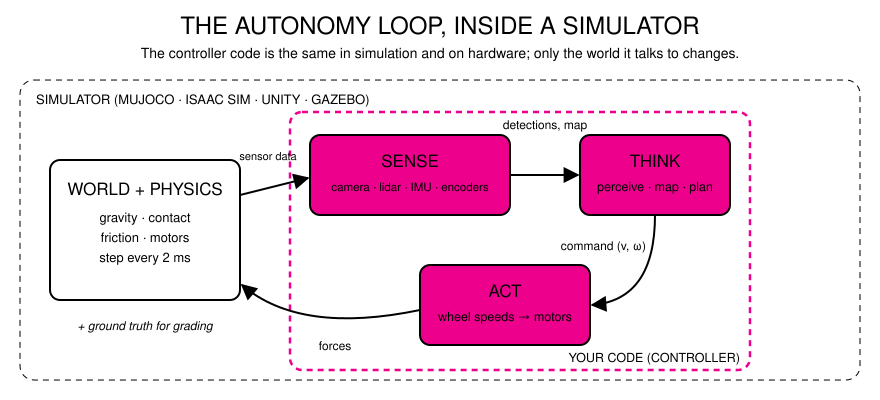

# 1 · Why Simulation

> *Explain the critical role of simulation in modern robotics development, testing, and education.*

Simulation accelerates robotics research and education by providing a safe,
scalable, and cost-effective environment to test algorithms before deploying on
physical hardware.

## What a robot simulator is

A robot simulator is four models running together, many times per second:

| Model | Answers the question | In this repo |
| --- | --- | --- |
| **World** | What is there? Floors, walls, objects, lights | `<worldbody>` in [`demo/assets/scad_lab.xml`](../demo/assets/scad_lab.xml) |
| **Robot** | What is it made of and how does it move? Links, joints, masses, motors | the `rover` body and its `<actuator>` block |
| **Physics** | What happens next? Gravity, contact, friction, motor torque | MuJoCo, stepping every 2 ms |
| **Sensors** | What does the robot perceive? Cameras, lidar, IMU, encoders, touch | the `<sensor>` block and the cameras |

Your code — the controller — sits in the middle. It reads sensors, decides, and
sends motor commands, exactly as it would on a real robot.

## Three roles

### Development
- **Iterate in seconds.** Change a gain, a wheel size or a sensor position and re-run. No soldering, no reprinting.
- **Design before you build.** Test whether a robot can climb the ramp *before* buying the motors.
- **Ground truth for free.** The simulator knows the exact position of everything, so you can measure your algorithm's error precisely.
- **Data generation.** Rendered images come with perfect labels, which is why simulation is used to train perception models (synthetic data).

### Testing
- **Safety.** Crash the robot a thousand times; nothing breaks and nobody is hurt.
- **Scale.** Run thousands of scenarios overnight, or in parallel on a GPU. Demo 6 measures this on the presentation laptop.
- **Repeatability.** The same seed gives the same run; a bug you saw once you can see again.
- **Edge cases on demand.** Ice, a dead motor, a sensor that drops out, a person who steps in front — scenarios you cannot stage safely on hardware.
- **Regression tests.** Every change to the code is checked against the same scenarios, the way software teams test any other product. This repo's `tests_environment/` is an example.

### Education
- **Every student gets a robot.** A lab of 30 students does not need 30 robots, and nobody waits for the one that works.
- **See the invisible.** Contact forces, lidar rays, planned paths and sensor noise can be drawn on screen.
- **Low cost of failure.** Students try bolder ideas when a mistake costs a restart, not a repair bill.
- **Bridges disciplines.** The same scene file is a 3-D asset, a physics model and a test environment, which makes it a natural meeting point for design, animation, games and engineering students.

## Where it shows up today

- **Locomotion.** Legged robots learn to walk with reinforcement learning in thousands of parallel simulated worlds, then transfer to hardware.
- **Manipulation and warehouses.** Picking and packing policies, and the digital twins of whole facilities.
- **Autonomous vehicles.** Most test miles are driven in simulation; rare and dangerous scenarios are generated deliberately.
- **Entertainment and performance robotics.** Choreography, camera robots and animatronics are previewed in simulation before rehearsal time on the real machine.
- **Benchmarks.** Research communities compare methods in shared simulated tasks; [ArtifactArena](https://artifactarena.ai), the project this repository was forked from, ranks robot designs by having them compete in MuJoCo (Demo 7).

## The catch: the reality gap

A simulator is a model, and every model is wrong somewhere: friction is a single
number, motors are ideal, cameras are clean, the floor is flat. Software that
exploits those simplifications fails on hardware. Segment 4 and Demo 5 are about
how practitioners close that gap.
