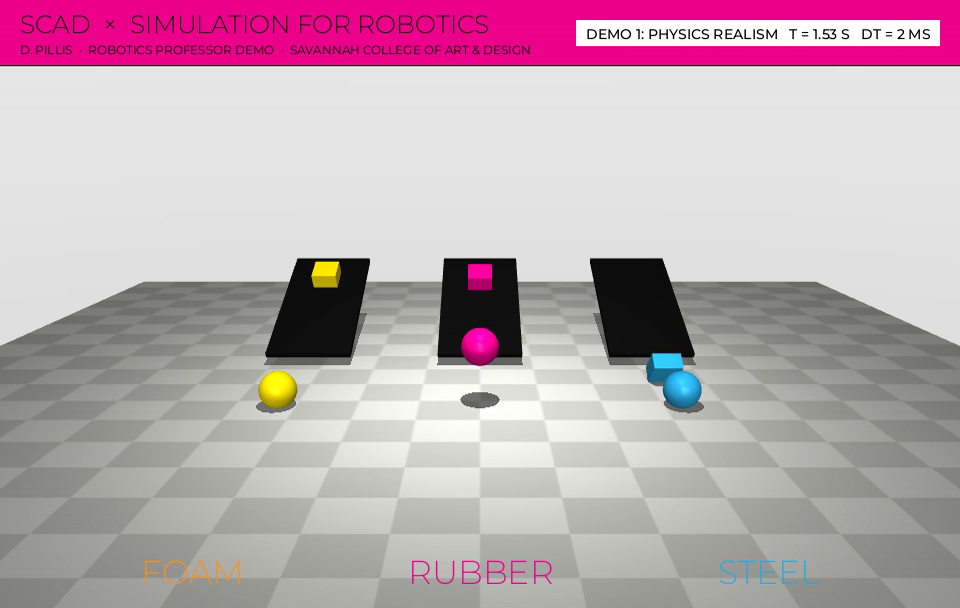
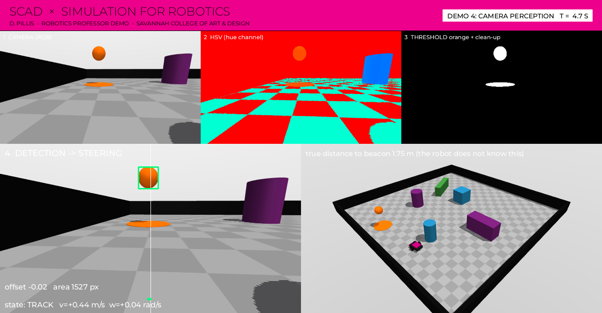

# 3 · Live Demonstration

> *Showcase a live (digital) robot simulation to illustrate real-time physics, perception pipeline integration, and environment interaction.*
>
> *Demonstrate basic robot control and sensor visualization within a real-time simulation engine.*

A live demonstration highlighting physics fidelity, sensor emulation, and rapid
prototyping capabilities. Everything runs on a laptop with MuJoCo; no GPU needed.

**The robot.** A small differential-drive rover (two driven wheels and a caster)
in a 6 × 6 m studio with five obstacles and an orange goal beacon. It carries the
sensor set of a real classroom robot: wheel encoders, an IMU, a bumper switch, a
15-beam planar lidar and an RGB-D camera. All of it is defined in one readable file:
[`demo/assets/scad_lab.xml`](../demo/assets/scad_lab.xml).

**Fallbacks.** `bash demo/render_all.sh` records every demo to `demo/output/`.
If the projector or a driver misbehaves, play the video and keep narrating.

---

## Demo 1 · Physics realism (3 min)

```bash
python demo/01_physics_playground.py
```

Three lanes, three materials: foam, rubber, steel. A ball drops, a block sits on a ramp.

- *Ask first:* which ball bounces highest? which block slides?
- Rubber bounces (springy contact), foam and steel do not; only steel slides (low friction).
- **Rapid prototyping moment:** open the file, change steel's friction from `0.25` to `1.0`, re-run. Ten seconds.
- **Physics fidelity moment:** `--timestep 0.03 --headless` — too large a time step and contact goes wrong. Realism is a set of choices with costs.



## Demo 2 · Basic robot control (4 min)

```bash
python demo/02_drive_the_robot.py        # macOS: mjpython demo/02_drive_the_robot.py
```

Drive with the arrow keys; **Enter** toggles the autopilot; **Page Up** moves the goal;
**Ctrl + right-drag** on the rover shoves it (environment interaction).

- The terminal prints the command (v, w) and the two wheel speeds it becomes.
  That conversion is differential-drive kinematics — two lines in `scad_sim.Rover.drive`.
- Each wheel is a velocity servo, a controller inside the simulated hardware.
- Turn on the autopilot (a proportional go-to-goal controller) and *ask*: "what will go wrong?"
  It drives straight into the blue box. It has no idea the box exists.


## Demo 3 · Sensors and the autonomy loop (5 min)

```bash
python demo/03_sensor_dashboard.py       # g = new goal, space = pause, q = quit
```

The same robot, now sensing. One window shows every sensor:
studio view with lidar rays · onboard RGB camera · depth camera ·
lidar plot · the occupancy map it is building · IMU traces · wheel commands vs. encoders.

- **Sensor emulation:** each panel is a simulated sensor; range, rate and noise are settings.
- **Perception pipeline:** lidar scan (10 Hz) → occupancy grid → inflated cost map → A* path → pure-pursuit steering. A safety layer and the bumper can override.
- Point at the wheel panel: command and encoder disagree while accelerating. Real motors lag too.
- Press **g** a few times: new goals, new routes, no new code.


## Demo 4 · A camera perception pipeline (3 min)

```bash
python demo/04_camera_perception.py
```

No map, no position: only the camera. The four panels are the pipeline:
RGB → HSV hue → threshold "orange" and clean up → largest blob → steering.
The rover searches, centres the beacon, approaches, and finishes the last half-metre by dead reckoning.

- Simulation knows exactly where the beacon is ("true distance" on screen), so it can grade the detector — and label training images automatically.
- *Ask:* "If I turned the beacon green, what breaks?" Then: hand-tuned thresholds are brittle; learned detectors trained on varied synthetic images are the modern answer.



## Demo 5 · The sim-to-real gap (2 min, runs in ~1 min)

```bash
python demo/05_sim_to_real_gap.py
```

Twelve randomized worlds: different floor and tire friction, robot mass, left/right
motor strength, plus sensor noise and 30 ms of latency.

- **Open loop** replays the wheel commands that worked perfectly in the ideal simulator. It scatters and crashes.
- **Closed loop** (Demo 3's stack) reaches the goal in nearly every world.
- This figure is the bridge back to the lecture: *if simulation is never exactly right, why trust it?*


## Optional

| Demo | Command | Use it when |
| --- | --- | --- |
| 6 · Scale and speed | `python demo/06_scale_and_speed.py` | Someone asks "how much faster than real time?" — prints the laptop's real-time factor and parallel throughput |
| 7 · Robot arena (capstone) | `python demo/07_robot_arena_match.py` | Showing where this leads: a full competition engine (ArtifactArena) where robots built as MuJoCo XML + Python fight on a ring |
